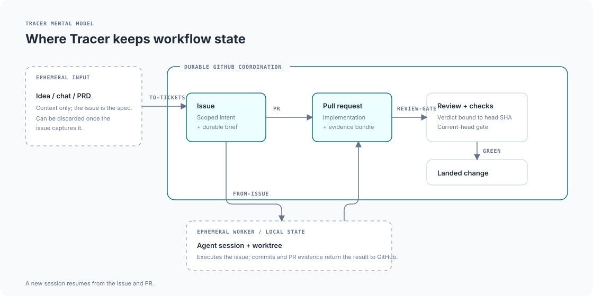

# tracer-workflow

An issue-backed, PR-mediated AI coding workflow. GitHub holds durable state in
issues, PRs, comments, and check runs. Chat transcripts are disposable.

[Operator setup: run tracer-workflow lanes from Herdr](./docs/operator/herdr.md).

The workflow exists because the record drifts from reality. Work can exist only
on a laptop and nowhere trusted. A session can claim tests pass while the checks
say otherwise. A review can approve code, then a later push leaves that approval
attached to an old commit.

Each stage closes one of those gaps. Intent becomes an issue. Work becomes a PR
with an evidence bundle. Review runs in a fresh session carrying none of the
planning thread's assumptions, and its verdict is stamped with the head SHA.
Push a new commit and the verdict becomes stale automatically. Check-run state,
rather than narrated confidence, decides readiness. A local monitor is available
to find commits no trusted remote holds, with an optional launchd schedule.

Sessions are good workers with bad memories. They can do the work, but GitHub is
the record.

This is a personal workflow. It is deliberately heavier than a small change
warrants, and earns its cost when work spans sessions, needs review, or would be
expensive to misremember.

Vocabulary is defined once in [CONTEXT.md](./CONTEXT.md). [WORKFLOW.md](./WORKFLOW.md)
defines the HITL/AFK rule, evidence-bundle contract, slice contract, check-run
gate, the `from-issue` execution-stage contract, and the full stage table.

## Trust architecture

The system separates disposable workers, durable authored GitHub records, and
observed repository state. Sessions and agents can perform work, but later stages
reconstruct authority from GitHub rather than trusting prior narration.

Source-backed architecture, provenance, drift, and the editable models live in [`docs/architecture/`](./docs/architecture/). The diagram source and visual constraints are documented in [`docs/diagrams/README.md`](./docs/diagrams/README.md).

The critical review rule is commit identity, not conversation continuity: a
verdict about SHA A cannot authorize work on SHA B. A new push returns the PR to
fresh review even when the implementation session itself continues.

## One issue, end to end

Issues come from a planning session, either through optional upstream
`to-tickets`, which applies `ready-for-agent`, or by filing issues directly.
`triage-queue` and `agent-brief` are optional for incoming or untriaged issues,
or when an issue body is not a complete execution contract; they are not
mandatory for every issue. `next` is a safety stub until #30.

`from-issue` is the execution stage for a `ready-for-agent` issue, or for a
validated pasted implementation handoff / durable agent brief that has been
accepted as equivalent execution input. It resumes the existing issue/worktree
when one exists, otherwise it cuts a branch, implements the slice, and opens a
PR carrying `Closes #N` and an evidence bundle — exact commands and their
output, anchored to the head SHA, rather than a prose claim that things work.

Once action-ready input is accepted, execution resumes the issue/worktree and proceeds to a PR with evidence or a durable blocker, as specified by [`from-issue`](./skills/from-issue/SKILL.md).

The active review gate is the `@review-gate` ChatGPT plugin, run in a fresh
conversation. [`skills/review-gate/`](./skills/review-gate/) remains its canonical
contract. The checked-in [`actions/review-gate-gpt/`](./actions/review-gate-gpt/)
package is available but is not the active entry point; the plugin posts a verdict
comment stamped with the reviewed head SHA.

On a `needs-fix` verdict, `from-pr-review` applies the fixes, replies per thread,
and pushes. The push moves the head SHA and invalidates the verdict, so the
circuit runs again. `needs-human` and `blocked` are hard stops. Once a current-head
`merge-candidate` verdict and the check-run gate agree, landing authority follows
the issue's autonomy tag: AFK work may land autonomously; HITL work stops for the
human merge button. The gate follows the current head's required status-check
configuration. The docs-only exception and canonical path allowlist are defined in
[`verdict-contract.md`](./skills/review-gate/references/verdict-contract.md):
applicable configured required checks must be green (when configured), `pr-body`
must pass on the current head, and Review Gate content review must be clean at
that head. Non-allowlisted and mixed changes retain ordinary changed-path
coverage. Older-head results never count.

## Where things live

Custom skills are versioned under `skills/`; this repo is their canonical source.
The canonical definitions for the ChatGPT-web triage prompts live under
`prompts/`; the Review Gate contract remains under `skills/review-gate/`. Issue
#15 tracks tighter parity plus the posting and supersession contracts around it.

The full stage table, including every skill, owner, and role, is in
[WORKFLOW.md](./WORKFLOW.md).

## Tooling

- `tooling/dependency-readiness/` — **available**: dependency readiness checks.
- `tooling/doctor/` — **available**: diagnoses local repository/runtime setup.
- `tooling/gate-packet/` — **available**: assembles current-head gate evidence.
- `tooling/gate-readiness/` — **active**: GitHub Actions workflows evaluate and
  reevaluate PR readiness.
- `tooling/gate-state/` — **available**: inventories repository gate state.
- `tooling/herdr-watcher/` — **available**: reports review verdict notifications
  in Herdr.
- `tooling/lib/` — **active**: shared review-gate verdict and eligibility logic.
- `tooling/review-gate-auto-merge/` — **available**: supports authorized AFK
  landing after the gate.
- `tooling/review-gate-autosend/` — **available**: opens the opt-in review-gate
  flow.
- `tooling/review-gate-poller/` — **parked** (#184): legacy poller, not active
  automation.
- `tooling/unbacked-work-monitor/` — **available**: local-only commit monitor
  with an optional launchd schedule.
- `actions/` — **available**: GitHub connector actions and the non-active Custom
  GPT package.
- `scripts/` — **active**: repository contract, package, and disclosure checks.

Verdict format and the two load-bearing review-gate rules, SHA-staleness and
comment-only operation, are defined in
[skills/review-gate/references/verdict-contract.md](./skills/review-gate/references/verdict-contract.md).
