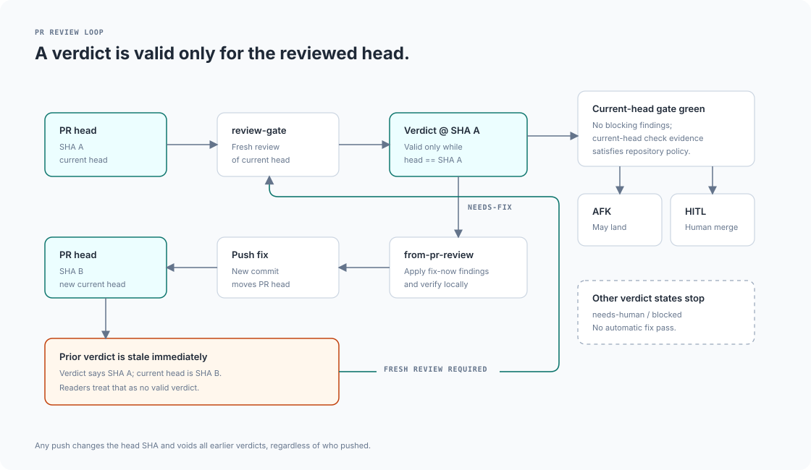

# tracer-workflow

Tracer is a GitHub issue-to-PR workflow for AI-assisted coding, with evidence and review bound to the pull request's head commit.

This is a personal workflow, deliberately heavier than a small change warrants, for work that spans sessions, needs review, or is expensive to misremember.

## The chain

`planning session → [optional upstream to-tickets] or direct issue filing → [optional triage-queue → agent-brief for incoming, untriaged, or incomplete issues] → from-issue → PR with closing issue reference + evidence bundle → @review-gate in a fresh ChatGPT conversation ⇄ from-pr-review for needs-fix → retest → check-run gate → merge candidate / human stop / follow-up issue`

`next` is a safety stub until #30, not a working selector.




## One verified example

[Issue #242](https://github.com/ptstory/tracer-workflow/issues/242) was completed by [merged PR #271](https://github.com/ptstory/tracer-workflow/pull/271), which includes its head-SHA evidence bundle. The PR's [merge-candidate review-gate verdict](https://github.com/ptstory/tracer-workflow/pull/271#issuecomment-6964767500) records the review loop.

## What is in this repo

| Path | What it is | Status |
|---|---|---|
| [`skills/from-issue/`](./skills/from-issue/) | Issue execution contract | Active; implementation runs in Crush |
| [`skills/from-pr-review/`](./skills/from-pr-review/) | Review-fix return contract | Active; fix passes run in Crush |
| [`skills/review-gate/`](./skills/review-gate/) | Canonical review-gate contract | Active; applied by the `@review-gate` plugin |
| [`actions/review-gate-gpt/`](./actions/review-gate-gpt/) | Custom GPT package | Available, but inactive as the review entry point |
| [`tooling/review-gate-poller/`](./tooling/review-gate-poller/) | Legacy review-gate poller | Parked, not in use |
| [`skills/next/`](./skills/next/) | Future next-work selector | Stub until #30 |

## Using a piece of it

Tracer's custom skills live in `skills/`. From the repository root, link an individual skill into the runtime skills directory (here, `from-issue`):

```sh
mkdir -p "$HOME/.agents/skills"
ln -s "$PWD/skills/from-issue" "$HOME/.agents/skills/from-issue"
```

The Custom GPT package is under [`actions/review-gate-gpt/`](./actions/review-gate-gpt/). The active `@review-gate` plugin implementation is not checked into this repository; `actions/review-gate-plugin/` does not exist, and issue [#195](https://github.com/ptstory/tracer-workflow/issues/195) tracks the plugin source. For local setup diagnostics, see [`tooling/doctor/`](./tooling/doctor/).

## What runs it today

Planning and interactive review use ChatGPT web or Claude web; `to-tickets` is an optional upstream planning method and issues can also be filed directly. Crush runs implementation and fix passes. GitHub issues, pull requests, comments, commits, and check runs hold durable workflow state. The active review gate is the `@review-gate` ChatGPT plugin in a fresh conversation. See [RUNTIME.md](./RUNTIME.md) for current bindings; the review-gate poller is parked.

## Reference

- [Workflow contract](./WORKFLOW.md)
- [Context and vocabulary](./CONTEXT.md)
- [Review-gate verdict contract](./skills/review-gate/references/verdict-contract.md)
